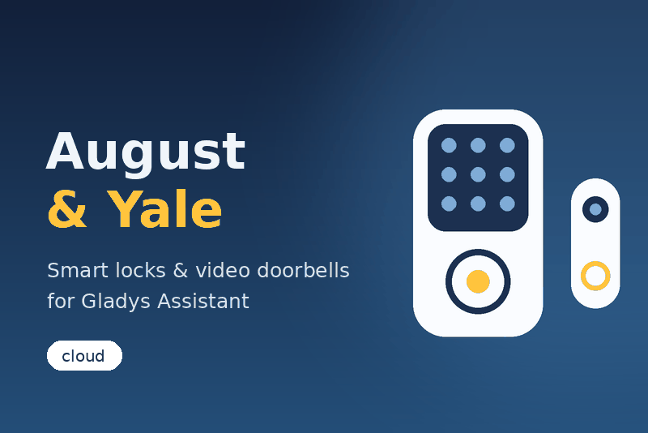

# August / Yale for Gladys Assistant

External integration bringing **August** and **Yale** smart locks and video
doorbells into [Gladys Assistant](https://gladysassistant.com) (5.1+), through
the August / Yale cloud. Built on the official
[integration template](https://github.com/GladysAssistant/integration-template-js)
and [SDK](https://github.com/GladysAssistant/integration-sdk-js).



## Features

| Surface           | What                                                                                                                   |
| ----------------- | ---------------------------------------------------------------------------------------------------------------------- |
| Accounts          | August, Yale Access (North America), Yale Home (Europe & world) — e-mail or phone login, 2FA code entered in Gladys    |
| Smart locks       | Lock / unlock (`lock` feature), battery, door open / closed (DoorSense), keypad battery, Wi-Fi bridge transport badge  |
| Video doorbells   | Latest snapshot (camera), ring, motion, battery                                                                        |
| Real time         | Events in seconds through the apps' real-time channel; the activity feed stays the source of truth                     |
| Scene triggers    | `lock_operated` (lock, action, method, user), `lock_jammed`, `doorbell_pressed`, `doorbell_motion`                     |
| Scene actions     | `lock_door`, `unlock_door`, `unlatch_door`, `refresh_doorbell_image` — with `success` / `state` outputs                |
| Dashboard widgets | `lock` (one lock with its buttons, or every lock), `doorbell` (image, last ring / motion), `activity` (who, how, when) |
| Safety            | "Allow unlocking from Gladys" option; unlock / open buttons ask for a confirmation                                     |
| Languages         | English, French, German, Spanish (manifest, messages, widgets, docs)                                                   |
| Transport         | `cloud` (the container has no Bluetooth)                                                                               |

User documentation: [English](docs/en.md) · [Français](docs/fr.md) ·
[Deutsch](docs/de.md) · [Español](docs/es.md).

## Install

In Gladys: **Integrations → Store → August / Yale**. To test a build before it
is in the store: **Integrations → Install an integration → Developer mode**, and
paste the manifest of the build summary of the _Build and publish image_
workflow.

## Development

```bash
npm install
npm test               # node --test, against the SDK's fake Gladys and a fake cloud
npm run lint
npm run format:check
```

Run it against a Gladys instance:

```bash
GLADYS_HOST_API_URL="http://localhost:1443" \
GLADYS_INTEGRATION_TOKEN="<token>" \
GLADYS_INTEGRATION_SELECTOR="august-yale" \
DATA_DIR=./data LOG_LEVEL=debug \
npm start
```

See [`CLAUDE.md`](CLAUDE.md) for the architecture and the project rules.

## Release

Describe the changes under `## [Unreleased]` in [`CHANGELOG.md`](CHANGELOG.md),
then **Actions → Release → Run workflow** (patch / minor / major): the workflow
bumps the version, tags, builds the `linux/amd64` + `linux/arm64` image to
`ghcr.io/gboulvin/gladys-august-yale` and publishes the GitHub Release.

## Disclaimer

Not affiliated with, endorsed or supported by ASSA ABLOY, August Home or Yale.
August and Yale are trademarks of their respective owners. The cloud API used
here is the one of the official apps and is not publicly documented: it may
change without notice.

## Security

See [`SECURITY.md`](SECURITY.md) — report vulnerabilities privately.

## License

Apache-2.0
